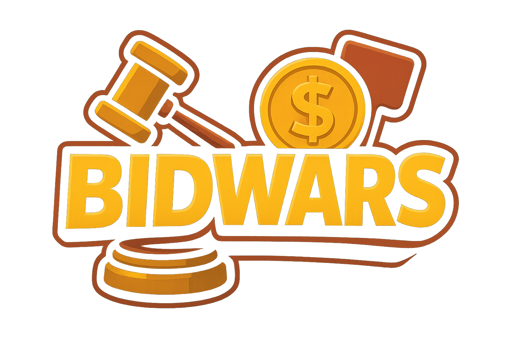
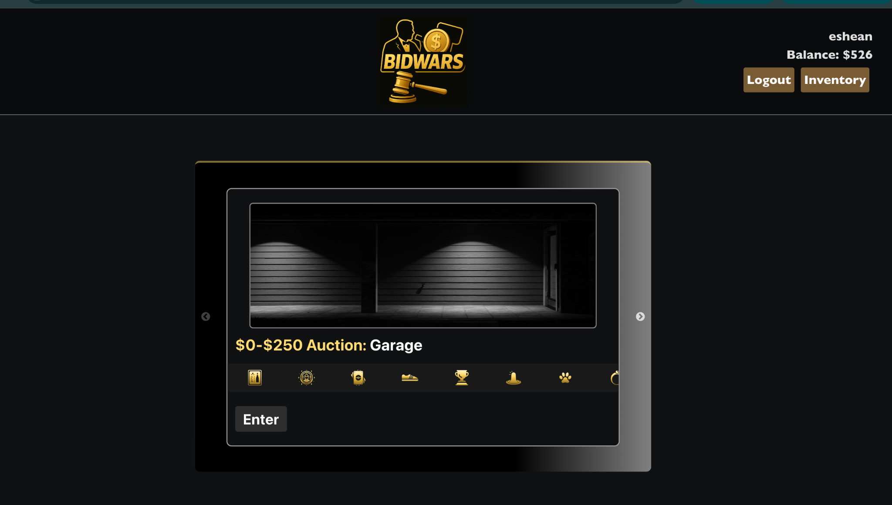
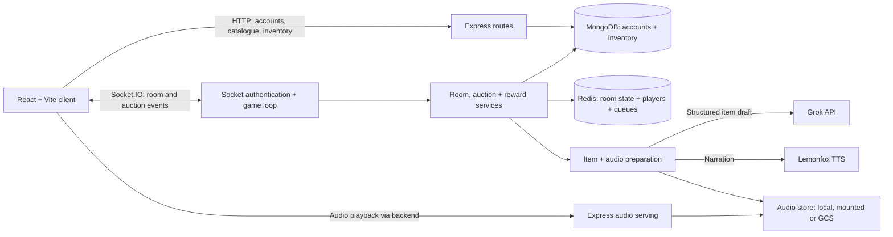

<p align="center">
  
</p>

# BidWars

**A real-time multiplayer auction game with timed bidding, persistent inventories, and an AI auctioneer.**

Choose a venue, compete for generated items, and decide how much of your limited
round-to-round balance to spend. BidWars combines a custom black-and-gold React
interface with a TypeScript backend that owns the auction lifecycle, broadcasts
room events, and prepares narrated items while players bid.

**TypeScript · React · Node.js · Express · Socket.IO · Redis · MongoDB · Grok · Lemonfox TTS**

**Measured locally:** next-item preparation during bidding reduced the mean
server-side gap between rounds from **24.61 s to 0.96 s (~96%)**, across two
transitions per version. [Results and scope](#measured-round-transition-improvement).

[Interface & demo](#interface--demo) · [Architecture](#architecture) ·
[Engineering decisions](#engineering-decisions) · [Run locally](#running-locally) ·
[Verification](#verification) · [Operations](#operations-reference)

## Interface & demo



*Auction selection screenshot from the original interface: themed venues, value
ranges, and a scrolling strip of item categories.*

The hosted demo is currently offline because external services, including speech
generation, incur ongoing usage costs. To try the game locally, follow the setup
below, create two accounts in separate browser profiles, and enter the same venue.
Rooms currently fill at **two players** and run **three rounds**, each with a
**20-second bidding window**. Provider preparation can add waiting time before
or between rounds.

Players receive venue-specific bid increments and an in-game balance. At each
round boundary, the backend settles the winning item and updates the winner's
balance. Items and account balance changes are persisted in MongoDB; the inventory
screen supports selling owned items.

## Architecture



Redis stores frequently changing room and player records; MongoDB stores accounts
and owned items. The backend process owns game timers, Socket.IO connections, and
pending preparation promises. Redis storage alone does not make that runtime
distributed or restart-safe.

### A round, from bid to settlement

1. **Join:** socket middleware verifies the account cookie or a room-scoped token.
   Connection handling checks participation and binds the player and room to the
   socket on the server.
2. **Open bidding:** the game loop broadcasts the item and a 20-second countdown.
   The client submits an absolute bid total; the backend uses the socket's bound
   identity, checks room membership, active status, and available in-game balance,
   then saves and broadcasts accepted bids within that room.
3. **Prepare ahead:** while bidding is open, the next item's draft and MP3 are
   prepared without changing the active item. There is at most one future item
   per game, and no unused fourth preparation after the third round.
4. **Close and settle:** the server stops accepting new bids and awaits accepted
   in-flight bid work before settlement. Reward handling updates MongoDB inventory
   and account balance, then updates the in-game balance in Redis.
5. **Advance:** the next prepared item is checked against its room, game, round,
   and transition IDs before activation using fresh room state. If it is not ready,
   the UI displays **Preparing next item…** with bidding disabled. The final round
   settles before the game disconnects its players.

## Engineering decisions

| Decision | What it enables | Trade-off / boundary |
| --- | --- | --- |
| Server-owned game loop | Round timing, bid acceptance windows, and settlement happen on the backend. | Timers and game ownership live in one process; interrupted games do not resume after restart. |
| Redis for room state; MongoDB for accounts and inventory | Separates transient gameplay records from persistent ownership. | Bid updates use read/modify/write operations; settlement spans separate writes without a cross-store transaction. |
| Socket-bound identity and purpose-specific JWTs | A bid payload cannot select another player's identity; account and room tokens have distinct verification contracts. | Tokens do not provide revocation, automatic connection expiry, or a single-connection policy. |
| Prepare the next item during the current round | Overlaps provider work with the existing bidding window. A failed speech attempt reuses the successful draft. | Provider outages can keep a game waiting: retries have capped exponential delays, but no retry-count limit or fallback item. |
| Cancellable preparation with scoped results | Abandoned games stop retries and discard late results and unused media. | Provider cancellation and failed-media cleanup are best effort. |
| Audio storage behind one playback URL | Local files, mounted storage, and a private GCS bucket share the same client path, cache behavior, and byte-range support. | Completed-round clips are retained; expiry needs a separate retention policy. |
| Dependency readiness and bounded shutdown | MongoDB, audio storage, and Redis initialization finish before listening; shutdown cancels games and drains work. | The eight-second shutdown deadline bounds cleanup and does not preserve active games. |

### Current boundaries

The server controls auction state, but bid amount validation and concurrency need
further work. The current bid service checks affordability and active status; it
does not enforce a finite positive amount, a minimum increase over the current
bid, or an atomic compare-and-update. Concurrent bids can overwrite each other.
Settlement also needs transactional recovery before it can offer exactly-once
awards and charges.

Run gameplay with one backend process. Multiple instances would need coordinated
game ownership and broadcasts, atomic state transitions, and restart recovery.
The frontend currently navigates home on socket disconnect. These are explicit
engineering boundaries, with additional scenarios tracked in the
[test backlog](backend/TEST_BACKLOG.md).

## Code tour

| Start here | Responsibility |
| --- | --- |
| [GameLogic.ts](backend/socket/GameLogic.ts) | Round lifecycle, bid listeners, preparation overlap, settlement, cancellation |
| [auctionService.ts](backend/services/auctionService.ts) | Bid checks and prepared-item activation |
| [itemPreparation.ts](backend/services/itemPreparation.ts) | Stage-specific retries, backoff, and cancellation |
| [roomRepository.ts](backend/repositories/roomRepository.ts) | Redis serialization, room/player records, matchmaking queues |
| [rewardService.ts](backend/services/rewardService.ts) | Persistent inventory and balance updates, in-game settlement |
| [AUTHENTICATION.md](backend/AUTHENTICATION.md) | Account/room token contracts and bid authorization |
| [BattleRoom.tsx](frontend/src/pages/BattleRoom.tsx) | Socket events, bidding UI, countdown, and narrated items |
| [audioStore.ts](backend/storage/audioStore.ts) | Shared audio storage contract and local-file implementation |
| [server.ts](backend/server.ts) | Dependency readiness, listener startup, and shutdown |

## Running locally

### Prerequisites

- Node.js and npm; the backend container uses Node 24.
- Reachable MongoDB and Redis instances, local or hosted.
- Grok and Lemonfox API keys for playable auctions. Gameplay makes paid provider
  requests; there is no offline item-generation mode.

Clone and install from the repository root (there is no root npm package):

```bash
git clone https://github.com/EsheanA/BidWars.git
cd BidWars
npm ci --prefix backend
npm ci --prefix frontend
```

Create `backend/.env` with your own values. Keep environment files untracked and
preserve any existing local configuration:

```dotenv
NODE_ENV=development
PORT=3000
MONGODB_URI=mongodb://127.0.0.1:27017/bidwars
REDIS_URL=redis://127.0.0.1:6379
ACCESS_TOKEN_SECRET=replace-with-a-long-random-secret
GROK_KEY=your-grok-api-key
LEMON_FOX_KEY=your-lemonfox-api-key
CORS_ALLOWED_ORIGINS=http://localhost:5173
AUDIO_STORAGE=local
```

These example database URLs assume MongoDB and Redis are already running on the
listed ports. `AUDIO_STORAGE=local` creates `backend/audioFiles/` automatically.

Create or update `frontend/.env`:

```dotenv
VITE_SERVER_BASE_URL=http://localhost:3000
```

Start each server in its own terminal, from the repository root:

```bash
# Terminal 1
cd backend
npm run dev
```

```bash
# Terminal 2
cd frontend
npm run dev
```

Open `http://localhost:5173/registration`, sign up, then use a second browser
profile for the other player. Use the same hostname consistently: login cookies
are `HttpOnly`, `Secure`, and `SameSite=None`, including in development. Local
HTTP authentication depends on the browser's localhost handling of Secure
cookies; check cookie acceptance if login does not persist. Deployed frontend and
backend origins must use HTTPS. See the
[browser and cookie deployment notes](backend/DOCKER.md#frontend-stays-on-vercel).

`VITE_SERVER_BASE_URL` is required and must be a backend HTTP(S) origin without an
API path. API calls, sockets, images, and audio use it; rebuild the frontend after
changing it for deployment.

## Verification

From the repository root, run the backend's isolated suite and TypeScript check:

```bash
npm run test:run --prefix backend
npm run typecheck --prefix backend
```

The Vitest suite covers token contracts, room membership, auction transitions,
preparation retries and cancellation, storage behavior, startup/shutdown, and
account/inventory routes with controlled dependencies. Providers, databases, and
sockets are mocked; these tests do not establish real Redis atomicity, live
provider compatibility, browser integration, or concurrent settlement correctness.
See [test scope and historical coverage](backend/TESTING.md). Use
`npm run typecheck --prefix backend` for the current no-output TypeScript check.

Frontend URL configuration checks run without browsers or external services:

```bash
cd frontend
npx --no-install playwright test tests/serverUrls.spec.ts --workers=1
```

The [two-player Playwright script](frontend/e2e/multiplayer.spec.ts) opens separate
browser contexts and pauses for manual exploration; it is not an automated
end-to-end correctness test. The [Docker guide](backend/DOCKER.md) also provides
an isolated MongoDB/Redis smoke harness for startup, static assets, audio ranges,
CORS, and shutdown without provider calls.

### Measured round-transition improvement

Preparing the next item during bidding reduced the average server-side transition
gap from **24.61 seconds to 0.96 seconds (about 96%)** in an initial local
two-player comparison. The measurement runs from the server round timer expiring
to the server emitting the next item; it excludes browser receipt and rendering.

| Transition | Before preparation overlap | With preparation overlap |
| --- | ---: | ---: |
| Round 1 → 2 | 30.93 s | 0.90 s |
| Round 2 → 3 | 18.28 s | 1.03 s |
| **Mean** | **24.61 s** | **0.96 s** |

The baseline logs show item generation taking 16–29 seconds, compared with about
0.5 seconds for settlement. Moving draft and speech preparation into the current
20-second round removed that provider work from the transition path when ready.
Both prefetched items were ready when bidding closed in this measured run.

This comparison contains **two transitions per version**, recorded on November 23,
2026 (UTC). It demonstrates an observed local improvement, not a production
latency guarantee or a capacity result. Provider variability, late preparation,
and a larger sample still need measurement. The
[extracted timing records and calculated summary](docs/performance/round-transition-sample.json)
are included so the numbers can be checked.

### Timing instrumentation

The backend records preparation attempts and round-transition durations, including
settlement, preparation wait, activation, and presence refresh. Records carry
room, game, round, and transition IDs. The frontend can log countdown-zero to
next-item receipt using the same context. See
[roundTiming.ts](backend/logging/roundTiming.ts) and
[BattleRoom.tsx](frontend/src/pages/BattleRoom.tsx).

The local comparison above measures round-transition delay. Bid-confirmation
latency, throughput, concurrent-room capacity, and deployed p50/p95 transition
latency have not been established by checked-in load-test results.

## Operations reference

The details below cover backend builds, origin configuration, storage, and
preparation behavior. For container builds and Cloud Run/Vercel configuration,
see [backend/DOCKER.md](backend/DOCKER.md).

### Backend Docker image

The backend has an Ubuntu 24.04 / Node 24 container setup; the frontend remains on
Vercel. See [backend/DOCKER.md](backend/DOCKER.md) for image builds, disposable local
MongoDB/Redis smoke checks, Cloud Storage permissions, and Vercel settings.
Use `backend/` as the Docker build context. Container builds exclude tests and
local data using the production TypeScript config and Docker context allowlist.

### Backend startup and shutdown

Compiled backend output is generated locally and is not tracked in Git. For a
production build, run `npm run build --prefix backend`, then
`npm start --prefix backend`.

The backend binds to `0.0.0.0` using `PORT` (default `3000` when unset).
An explicitly supplied port must be an integer from `1` to `65535`.
MongoDB and Redis/socket initialization finish before the HTTP listener opens.
Initial Redis connection attempts are limited to 10 seconds; startup failures
close resources and leave the process with a nonzero exit status.

On `SIGTERM` or `SIGINT`, the server stops accepting players, cancels round timers
and item preparation, and drains existing HTTP/socket/game work before closing
Redis and MongoDB. Shutdown runs once even if multiple signals arrive. A failed
cleanup or an 8-second shutdown timeout terminates the process unsuccessfully.
Active games are interrupted by shutdown; their runtime state is not resumed
automatically after a restart.

### Frontend origins and backend URLs

Set `CORS_ALLOWED_ORIGINS` on the backend to the exact frontend origins that may
make browser requests, separated by commas. For example:

```dotenv
NODE_ENV=production
CORS_ALLOWED_ORIGINS=https://bidwars.example,https://preview.bidwars.example
```

Production requires a nonempty list. Development also allows HTTP/HTTPS localhost
origins so the existing local setup keeps working. Include protocol and any
non-default port; paths, credentials and wildcards are rejected. Root trailing
slashes are normalized. The same credentialed policy applies to HTTP requests,
Socket.IO and static assets. Requests without an Origin header remain allowed;
authentication still applies to protected operations.

Set the frontend's `VITE_SERVER_BASE_URL` to the backend origin before starting
Vite or building the frontend. API requests, sockets, audio and backend images all
use this setting. For example, in your local frontend environment:

```dotenv
VITE_SERVER_BASE_URL=http://localhost:3000
```

For deployment, replace that value with your backend's HTTPS origin. This is a
frontend build-time setting, so rebuild after changing it. Use an origin without
an API path, query, credentials or fragment; a root trailing slash is supported.
The `.example` domains above are placeholders, not deployed services.

Run the isolated frontend URL checks from the frontend directory:

```bash
npx --no-install playwright test tests/serverUrls.spec.ts --workers=1
```

These tests use no browsers, development servers or external services.

### Static assets and audio storage

`npm run build --prefix backend` compiles TypeScript and copies `BidWarsSVGs/` and
`GoldSVGs/` into `backend/dist/`. Generated audio is not copied into the build.
Use `npm run typecheck --prefix backend` for TypeScript checks without generating
output; appending `--noEmit` to the build command is no longer the check command.

Production requires an explicit audio storage mode. Local development defaults to
`local` and creates `backend/audioFiles/` automatically. Relative `AUDIO_DIRECTORY`
paths resolve against `backend/` in both source and compiled execution.

| Mode | Configuration |
| --- | --- |
| `local` | Optional `AUDIO_DIRECTORY`, defaults to `backend/audioFiles/`. |
| `gcs` | Set `AUDIO_BUCKET` to a private bucket name. Cloud Run uses its attached service account to access the Cloud Storage API. |
| `mounted` | Set `AUDIO_DIRECTORY` to an existing, writable absolute mount path. |

For direct bucket access, grant the Cloud Run service account **Storage Object User**
(`roles/storage.objectUser`) on the audio bucket. The server checks that it can
list objects before it starts accepting traffic. See [the deployment guide](backend/DOCKER.md)
for the Cloud Run settings and checks.

All modes use the same `/audioFiles/...` playback URLs and retain browser caching,
ETags, HEAD and single byte ranges. The private bucket stays behind the backend.
In `gcs` mode, audio is ready after its object upload succeeds. The backend uses
unique MP3 names at the bucket root and rejects writes that would overwrite an
existing object. Unused prepared clips are removed through the same storage mode.
Completed-round audio is retained. Configure a bucket lifecycle policy separately
if those clips should expire. Existing local clips stay in their original directory.

### Preparing the next auction item

Each game prepares one future item while the current item is open for its usual
20 seconds. Preparation generates a draft and finishes its MP3 without writing
room state. When the timer expires, bidding closes, accepted in-flight bids finish,
and the current item is settled. The game awaits the same preparation promise,
loads fresh room state, and activates that result. It never prepares a fourth item
for a three-round game.

Failed stages retry with increasing delays. A speech failure retains the generated
item and retries speech only. The initial item also uses this retry policy before
gameplay starts. There is no fallback item or retry-count limit; between rounds the
client shows **Preparing next item…** with bidding disabled until preparation is
ready. Provider requests have a 60-second attempt timeout. These backend settings
control retry delays (positive integer milliseconds; invalid values use defaults):

| Setting | Default | Meaning |
| --- | ---: | --- |
| `ITEM_PREPARATION_RETRY_MS` | 1000 | First retry delay, limited to the cap |
| `ITEM_PREPARATION_RETRY_CAP_MS` | 10000 | Maximum delay as retries double |
| `ROUND_TIMING_LOGS` | true | Set `false` to disable backend timing records |
| `ROUND_TIMING_DETAILS` | false | Set `true` for individual transition-stage records |

Preparation is owned by one game loop in the current backend process. Results carry
room, game, round, and transition IDs; activation checks these and an abort signal.
When the last connected socket leaves a room, its game is considered abandoned:
requests are aborted, retry timers stop, and unused completed media is removed.
Late results are discarded; failed or aborted audio streams remove partial files.
A failed file removal is logged and can require manual cleanup. Cancellation is best
effort at the provider and cannot guarantee that an already sent request is unbilled.

This does not add recovery after process restarts, distributed game ownership, or
resumption after abandonment. Existing settlement persistence/error handling and
other authorization, amount, and connection-count policies remain in place.

